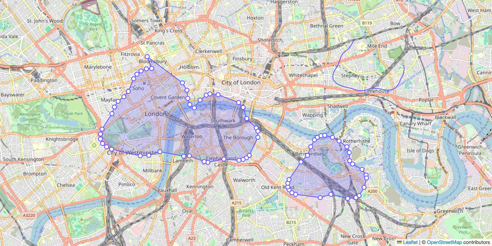

<div align="center">

# ✏️ Leaflet Draw Shapes

**Freehand polygon drawing for [Leaflet](https://leafletjs.com).**
Sketch shapes with a mouse, pen or finger. Overlapping shapes merge, vertices drag, edges split, and everything comes back as GeoJSON.

[](https://github.com/Nalhin/leaflet-draw-shapes/actions/workflows/ci.yml)
[](https://www.npmjs.com/package/leaflet-draw-shapes)
[](https://www.npmjs.com/package/leaflet-draw-shapes)
[](https://www.npmjs.com/package/leaflet-draw-shapes)
[](LICENSE.md)

### [Try the live demo →](https://nalhin.github.io/leaflet-draw-shapes/)

[](https://nalhin.github.io/leaflet-draw-shapes/)

</div>

## Features

- 🖊️ **Freehand drawing** with mouse, pen and touch.
- 🧲 **Smart shapes.** Strokes are cleaned up with a concave hull, self-intersections are split, and overlapping shapes merge.
- 🎛️ **Composable modes.** Create, edit, delete and append are bit flags, so you can combine them however you like.
- 🗺️ **A real Leaflet layer.** `DrawLayer` is a `FeatureGroup`, so `toGeoJSON()`, `getBounds()` and `getLayers()` just work.
- 🎨 **One-line theming.** No CSS to import. A single `color` themes shapes, handles and the stroke, and a typed `style` object handles the rest, live.
- 🦺 **TypeScript-first.** Strictly typed, including typed event listeners.
- 📦 **Light.** About 6 kB gzipped, ships ESM and CJS, and depends only on `clipper-lib`.

## Install

```sh
npm install leaflet-draw-shapes leaflet
# or
pnpm add leaflet-draw-shapes leaflet
```

Supports Leaflet `1.8` and `1.9`.

## Quick start

```ts
import 'leaflet/dist/leaflet.css';
import { map, tileLayer } from 'leaflet';
import { drawLayer, CREATE, EDIT } from 'leaflet-draw-shapes';

const myMap = map('map').setView([51.505, -0.09], 13);
tileLayer('https://tile.openstreetmap.org/{z}/{x}/{y}.png', {
  attribution: '&copy; OpenStreetMap contributors',
}).addTo(myMap);

const shapes = drawLayer({
  mode: CREATE | EDIT,
  style: { color: '#6d5efc' },
}).addTo(myMap);

shapes.on('markers', ({ latLngs, eventType }) => {
  console.log(`${eventType}: ${latLngs.length} shapes`);
});

// Later…
const geojson = shapes.toGeoJSON();
```

## Modes

Modes are bit flags. Combine them with `|` and toggle them with `^`.

| Flag          | Value | What it does                                                                                                                     |
| ------------- | ----- | -------------------------------------------------------------------------------------------------------------------------------- |
| `NONE`        | `0`   | Read-only.                                                                                                                       |
| `CREATE`      | `1`   | Draw new shapes. Map panning is paused while active.                                                                             |
| `EDIT`        | `2`   | Drag vertices.                                                                                                                   |
| `DELETE`      | `4`   | Click a shape to remove it.                                                                                                      |
| `APPEND`      | `8`   | Click near an edge to insert a vertex.                                                                                           |
| `EDIT_APPEND` | `10`  | `EDIT \| APPEND`                                                                                                                 |
| `ALL`         | `15`  | Everything. With `DELETE` and `APPEND` both on, clicks within `elbowDistance` px of an edge append and clicks further in delete. |

```ts
shapes.mode(CREATE | DELETE); // set
shapes.mode(shapes.mode() ^ CREATE); // toggle CREATE
```

The active modes are also added to the map container as classes (`mode-create`, `mode-edit`, `mode-delete`, `mode-append` and `mode-none`), which makes styling easy.

## Options

| Option                 | Default    | Description                                                            |
| ---------------------- | ---------- | ---------------------------------------------------------------------- |
| `mode`                 | `ALL`      | Initial mode.                                                          |
| `style`                | see below  | How everything looks. See [Styling](#styling).                         |
| `mergePolygons`        | `true`     | Merge shapes that overlap.                                             |
| `concavePolygon`       | `true`     | Run a concave hull over freehand strokes to tidy them up.              |
| `maximumPolygons`      | `Infinity` | Maximum number of shapes on the layer.                                 |
| `leaveModeAfterCreate` | `false`    | Leave `CREATE` mode after each stroke.                                 |
| `notifyAfterEditExit`  | `false`    | Hold back the `markers` event for vertex edits until the mode changes. |
| `elbowDistance`        | `10`       | Pixel distance from an edge that counts as an append click.            |
| `simplifyFactor`       | `1.1`      | Pixel distance under which near-duplicate vertices are dropped.        |
| `smoothFactor`         | `0.3`      | Leaflet's polyline smoothing for the rendered outline.                 |

## API

`DrawLayer` extends [`L.FeatureGroup`](https://leafletjs.com/reference.html#featuregroup). On top of that it has:

| Method                      | Returns          | Description                                                                                                   |
| --------------------------- | ---------------- | ------------------------------------------------------------------------------------------------------------- |
| `create(latLngs, options?)` | `Polygon[]`      | Add a shape from `LatLng`s, `{ lat, lng }` objects or `[lat, lng]` tuples. Skips the concave hull by default. |
| `removePolygon(polygon)`    | `void`           | Remove one shape.                                                                                             |
| `clear()`                   | `void`           | Remove every shape.                                                                                           |
| `mode(mode?)`               | `Mode`           | Get the mode, or set it and get it back.                                                                      |
| `style(style?)`             | `DrawLayerStyle` | Get the style, or merge in changes. Existing shapes update immediately.                                       |
| `all()`                     | `Polygon[]`      | Every shape, in creation order.                                                                               |
| `size()`                    | `number`         | Number of shapes.                                                                                             |
| `cancel()`                  | `void`           | Abandon the stroke in progress. Handy for an `Escape` key binding.                                            |

Use `drawLayer(options)` or `new DrawLayer(options)`. Removing the layer from the map also removes its shapes and listeners.

### Events

Listeners are fully typed:

```ts
import type { MarkersEvent, ModeEvent } from 'leaflet-draw-shapes';

shapes.on('markers', (event: MarkersEvent) => {
  event.eventType; // 'create' | 'edit' | 'append' | 'remove' | 'clear'
  event.latLngs; // LatLng[][], one closed ring per shape
});

shapes.on('mode', (event: ModeEvent) => event.mode);
```

## Styling

There's no CSS to import. Everything is styled from JavaScript through one typed `style` option.

Start with a single accent colour, which themes the shapes, vertex handles and drawing stroke together:

```ts
drawLayer({ style: { color: 'tomato' } });
```

Then fine-tune any part. `polygon` takes Leaflet [path options](https://leafletjs.com/reference.html#path-option), and `vertex` takes [circle marker options](https://leafletjs.com/reference.html#circlemarker-option):

```ts
drawLayer({
  style: {
    color: '#6d5efc',
    polygon: { weight: 2, fillOpacity: 0.25, dashArray: '6 4' },
    vertex: { radius: 6, fillColor: '#fff' },
    stroke: { width: 3, opacity: 0.8 },
  },
});
```

| Part      | Type                                                                       | Defaults                             |
| --------- | -------------------------------------------------------------------------- | ------------------------------------ |
| `color`   | `string`                                                                   | `'#3388ff'`, Leaflet's blue          |
| `polygon` | [`PathOptions`](https://leafletjs.com/reference.html#path-option)          | Leaflet's defaults                   |
| `vertex`  | [`CircleMarkerOptions`](https://leafletjs.com/reference.html#circlemarker) | `radius: 5`, `weight: 2`, white fill |
| `stroke`  | `{ color, width, opacity, dashArray }`                                     | `width: 2`, `opacity: 1`             |

### Changing the style at runtime

`style()` works like `mode()`: call it with no arguments to read the style, or pass a partial style to merge in. Existing shapes and handles update immediately.

```ts
shapes.style({ color: darkMode ? '#a5b4fc' : '#4f46e5' });
shapes.style(); // the current style
```

### Prefer CSS?

Every element also has a class, so you can style with CSS instead. CSS rules override the SVG attributes set from `style`.

| Class                                   | Element                                  |
| --------------------------------------- | ---------------------------------------- |
| `.leaflet-polygon`                      | Drawn shapes                             |
| `.leaflet-edge`                         | Vertex handles, shown in `EDIT` mode     |
| `svg.leaflet-draw-shapes .leaflet-line` | The stroke while drawing                 |
| `.mode-*`                               | Map container, one class per active mode |

## React Leaflet

```tsx
import { useEffect } from 'react';
import { useMap } from 'react-leaflet';
import { drawLayer, CREATE, type MarkersEvent } from 'leaflet-draw-shapes';

export function DrawShapes({
  onChange,
}: {
  onChange: (e: MarkersEvent) => void;
}) {
  const map = useMap();

  useEffect(() => {
    const layer = drawLayer({ mode: CREATE }).addTo(map);
    layer.on('markers', onChange);
    return () => void layer.remove();
  }, [map, onChange]);

  return null;
}
```

## Upgrading from 1.x

Version 2 is a TypeScript rewrite. Most code keeps working; the breaking changes are:

- **Package layout.** Files moved from `build/` to `dist/`, and the package now has an `exports` map (ESM plus CJS). Deep imports such as `leaflet-draw-shapes/build/...` no longer resolve.
- **Internal exports removed.** `polygons`, `instanceKey`, `modesKey`, `edgesKey`, `notifyDeferredKey` and the `map.simplifyPolygon` hook are gone. Use `all()`, `mode()` and the events instead.
- **Removing the layer cleans up.** Shapes, vertex handles and DOM listeners are removed, and map dragging is restored.
- **Shapes are children of the layer.** `getLayers()`, `toGeoJSON()` and `getBounds()` now return them.
- **Styling moved to `style`.** Polygon path options such as `color` now go in `style.polygon`, or use `style.color` to theme everything. `strokeWidth` still works but is deprecated. Vertex handles are SVG circles now, so old `.leaflet-edge` CSS for `DivIcon`s needs updating.
- **`create()`** always returns an array (`[]` when off-map), includes the new shape when nothing merged with it, and accepts `[lat, lng]` tuples.
- **`markers` events** are no longer fired for clicks that didn't draw anything. Appending a vertex while both `DELETE` and `APPEND` are active now reports `'append'` instead of `'remove'`.

See the [changelog](CHANGELOG.md) for the full list, including bug fixes.

## Development

```sh
pnpm install
pnpm dev          # demo at http://localhost:5173, using the source directly
pnpm test         # vitest (jsdom + a real Leaflet map)
pnpm check        # lint, format, typecheck, test and build: everything CI runs
```

Releases are published from GitHub Releases. See [CONTRIBUTING.md](CONTRIBUTING.md#releasing).

## Credits

Based on [Leaflet.FreeDraw](https://github.com/Wildhoney/Leaflet.FreeDraw) by Adam Timberlake, including a TypeScript port of his [ConcaveHull](https://github.com/Wildhoney/ConcaveHull). Polygon operations use [Clipper](https://sourceforge.net/projects/jsclipper/).

## License

[MIT](LICENSE.md) © Krzysztof Olipra
